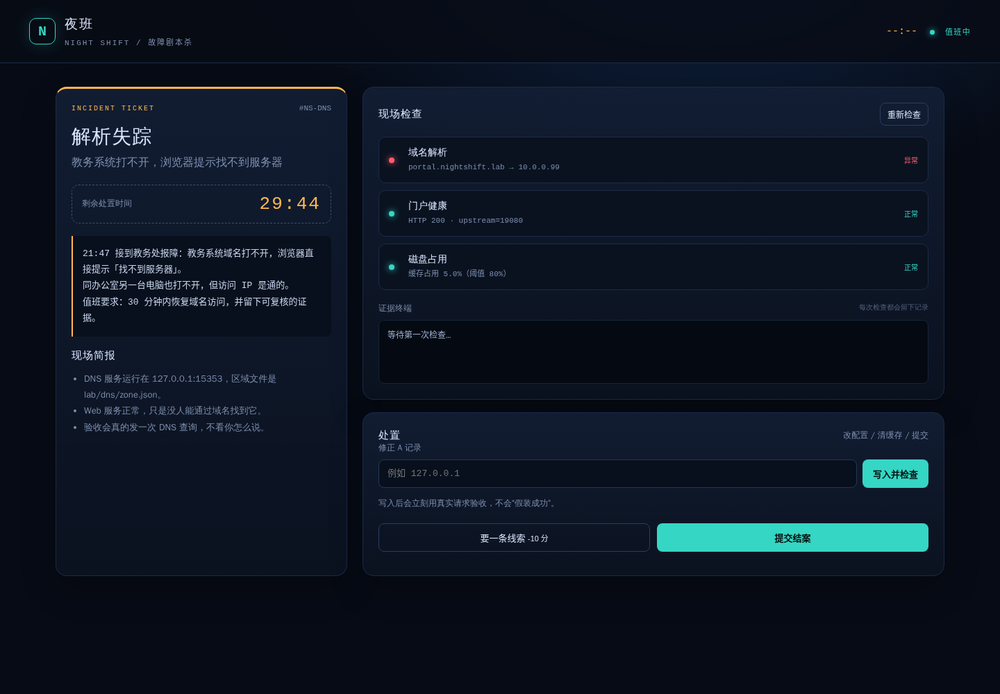

# 夜班 · 故障剧本杀

> 一台真服务器、一张工单、三十分钟倒计时。故障是随机注入的，修没修好由系统验收。

不是教程，不是题库，也不是“跟着步骤点下一步”的模拟器。你拿到的是一个真的坏掉的本地实验环境：DNS 真的解析错、HTTP 真的返回 502、磁盘真的爆。改配置、清缓存、提交结案，验收会发真实请求，不听你怎么说。



## 现在能玩什么

内置三个剧本，每个都对应一套真实服务：

| 剧本 | 现象 | 你要修什么 |
| --- | --- | --- |
| `解析失踪` | `portal.nightshift.lab` 解析到 10.0.0.99，网页打不开 | 修正 DNS 区域文件里的 A 记录 |
| `上游失联` | 门户 `/health` 返回 502 | 把 Web 配置里的 `upstream_port` 改回实际端口 |
| `缓存撑爆` | 磁盘占用 80%，`/health` 返回 507 | 清理 `cache.bin`，让占用降下来 |

三个剧本共用同一条验收逻辑：DNS 真查询、HTTP 真请求、磁盘真统计。不是前端写死“通过”。

## 跑起来

```bash
python -m night_shift --scenario dns --time 1800
```

打开 `http://127.0.0.1:18081`。终端会打印实验目录，默认是 `./lab`。

也可以直接改文件，不用网页：

```bash
cat lab/dns/zone.json
python -m json.tool lab/dns/zone.json
```

修复后回到值班台点「提交结案」。评分规则：

- 初始 100 分
- 每用一条线索扣 10 分
- 超过 5 分钟后，每多 1 分钟扣 2 分
- 三项真实验收全过，且在时限内，才算结案

结案报告写到 `lab/report.json`，包含根因、验收证据、操作时间线和得分。

## 它到底“真”在哪

- **DNS** 是一个真的 UDP DNS 服务器，监听 `127.0.0.1:15353`，每次查询都重新读 `lab/dns/zone.json`。
- **Web** 是一个真的 HTTP 服务，监听 `127.0.0.1:18080`，每次请求都重新读 `lab/web/config.json`。
- **磁盘** 检查读的是 `lab/disk` 下的真实文件大小，不是假进度条。
- **验收** 由 `night_shift/engine.py` 发起真实 DNS 查询和 HTTP 请求；前端只能调用受控动作，不能执行任意命令。

## 结构

```
night_shift/
  engine.py      # 起服务、注入故障、验收、计分、报告
  services.py    # 真 DNS / 真 HTTP / 磁盘统计
  scenarios.py   # 三个剧本的工单、根因、线索
  console.py     # 值班台 API（只开放受控动作）
  web/           # 值班台前端
tests/           # 6 项测试，覆盖三个剧本、计分和线索上限
```

## 边界

- 当前 MVP 用本地 Python 服务模拟“故障现场”，**不是** Windows Server / Hyper-V 剧本包。Windows Server 的 AD、DNS、DHCP、IIS、CA、DFS 剧本是下一阶段，需要独立实验网和快照重置。
- 不要在生产机、办公网或宿主机上跑故障注入。实验目录默认 `./lab`，服务只监听 `127.0.0.1`。
- 端口可被 `--dns-port` / `--web-port` / `--port` 覆盖；工单里的端口会跟着变。
- 计时、评分和“线索”是游戏机制，不是运维考核标准。

## Roadmap

- [ ] Hyper-V / Windows Server 剧本包：AD DNS、DHCP 作用域、IIS 证书链、DFS 复制、CA
- [ ] 剧本 DSL：用 YAML 描述注入脚本、验收脚本、线索和分值
- [ ] 多人值班：两个人共用一张工单，操作记录合并
- [ ] 赛后复盘：导出 Markdown 值班报告，回放每一步

## License

MIT
